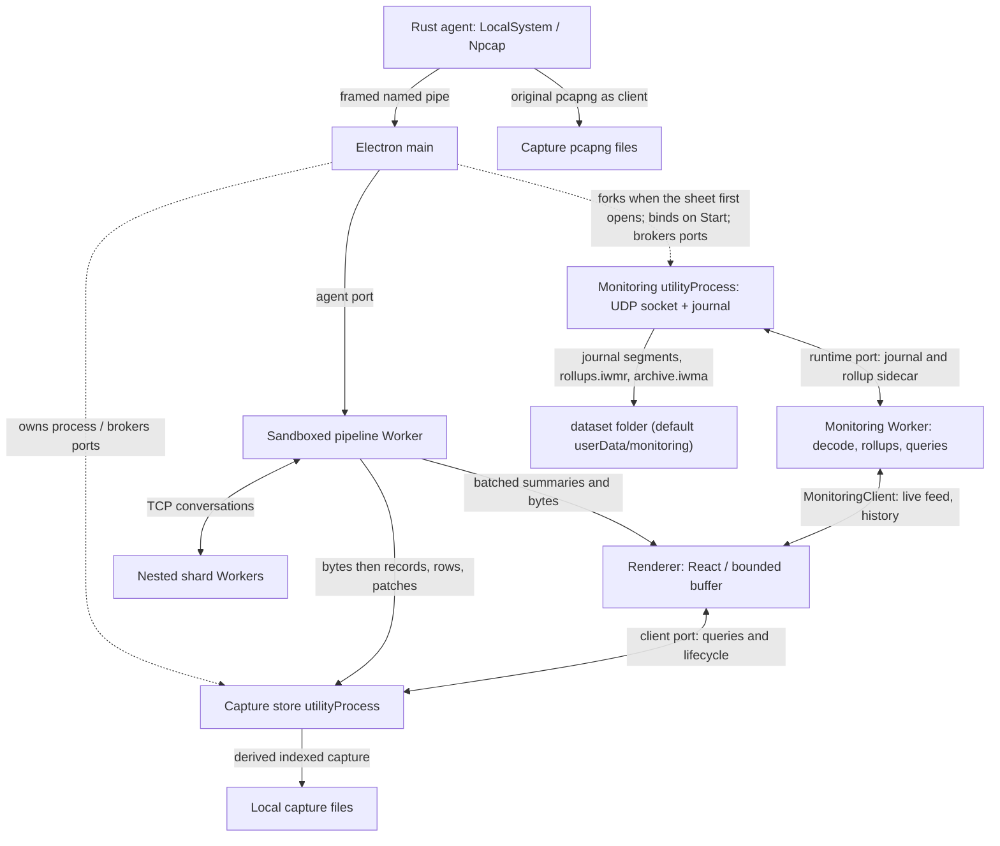

# Architecture reference

This describes the current implementation. [CLAUDE.md](../CLAUDE.md) is the
short working guide; [SCOPE.md](../SCOPE.md) defines product scope; the
[decision ledger](decisions/README.md) records rationale and amendments.
Historical incidents belong in [history.md](history.md), and manual runtime
evidence belongs in [verification.md](verification.md).

## Process topology

Inwire is a Windows Electron desktop application: React and Vite under
`app://inwire`, TypeScript protocol dissection, and a separate capture service.
There is no hosted application or browser build. Distribution is currently
source-only; locally built Windows installers include the Rust agent.
The Python agent remains the macOS/Linux implementation and the Windows
comparison baseline; those platforms do not yet have the desktop app.

Main owns OS resources, the custom protocol, windows, native dialogs, quit
guard, agent supervision and child-process lifetimes. Its adapters delegate
decisions to plain modules: for example `pipeTransport.ts`, `saveSession.ts`,
`window.ts`, `agentService.ts` and `updateCenter/manifest.ts` under `electron/`.
This lets scripts exercise the decisions without importing Electron.

The renderer is sandboxed with context isolation and Node disabled, including
inside Workers. The preload is one bundled CommonJS file with `electron` as
its runtime import. The store needs synchronous filesystem access; putting it
in a renderer Worker would require privileges incompatible with this boundary.
See [ADR 0028](decisions/0028-where-the-capture-store-runs.md).

`electron/main.ts` sets userData to Local rather than Roaming before creating
resources. Captures normally live in `%LOCALAPPDATA%\Inwire\captures`.
`INWIRE_USER_DATA` and `INWIRE_AGENT_PIPE` isolate runtime tests from personal
captures and the installed service; never point synthetic drives at those by
accident.

`App.tsx` is the renderer controller. `useAgentConnection` owns link state,
interfaces, capture state and health; its callbacks use refs so new render
identities do not reconnect the agent. `usePacketBuffer` owns arrival queues,
accounting and flushing. The non-React `services/packetBuffer.ts` separates
`prepareBatch` work that must happen once from `commitBatch`, which tolerates
React repeating a commit.

Keyboard listeners read current state through refs. Space toggles capture only
in explicitly permitted body/grid contexts, so focused controls retain their
own activation. `src/lib/commands.ts` supplies the shared shortcut/palette
vocabulary. UI layout, drag regions and render-path rules live in
[src/components/CLAUDE.md](../src/components/CLAUDE.md).

Besides the store, main forks two more utility processes, each for an explicit
user action: the speed test by `electron/speedTest/host.ts`, and the monitoring
collector by `electron/monitoring/host.ts` (see [NetFlow monitoring](#netflow-monitoring)).
The speed test uses Node HTTPS for controlled measurement,
not the capture agent. Its method and result state live under
`src/services/speedTest/`; see [ADR 0054](decisions/0054-an-internet-speed-test-against-cloudflare.md).

## Capture agent and host observations

The Rust service in `agent-rs/` holds the capture handles and Npcap library.
Electron never opens a capture handle. The separation permits administrator-only
Npcap devices while keeping privileged capture out of protocol dissection.
See [ADR 0033](decisions/0033-the-agent-stays-a-separate-service.md).

The service is demand-start. Main asks the SCM to start it without blocking
window creation. Interactive users get service-start permission, not
service-stop permission; the agent stops itself after its last client leaves.
A capture cannot continue unattended after all clients disconnect.
[ADR 0035](decisions/0035-the-agent-lives-as-long-as-the-app.md) covers lifetime.

The Windows transport is `\\.\pipe\inwire-agent`. Its ACL grants SYSTEM and
administrators full access and interactive users read/write access; remote
clients are rejected. Local connection permission and capture ownership are
separate checks. Windows has no pairing handshake, token, origin allowlist or
localhost WebSocket. Python retains authenticated WebSocket transport for Unix.
See [ADR 0029](decisions/0029-the-app-and-the-agent-talk-over-a-named-pipe.md)
and [local-agent/CLAUDE.md](../local-agent/CLAUDE.md).

The agent reads raw frames with `pcap_next_ex`, batches them, and reports driver
and queue drops. It does not compute protocol summaries. Device timestamps,
interface indices and per-capture sequence numbers accompany the bytes.
Capture filters and snaplen are applied by libpcap before frames are read;
invalid options are rejected rather than replaced with defaults. Capture adapter
selection remains fixed for that capture. See [ADR 0048](decisions/0048-a-captures-adapters-are-fixed-for-its-life.md)
and [ADR 0050](decisions/0050-a-capture-is-narrowed-by-the-driver.md).

Npcap's kernel buffer is sized per core, floored and capped because it uses
non-paged memory. Measurements are in
[bursts-and-what-wireshark-does.md](bursts-and-what-wireshark-does.md).
The agent also supplies socket/process attribution and adapter observations;
these are observations from the captured host, not third-party enrichment.
`src/services/agentHealth.ts` interprets service facts read by main and distinguishes
missing, disabled, stopped and repeatedly failing service states.

Rust and Python behavior changes must stay aligned through shared binary,
command and control vectors and message-coverage checks. The product installer
ships `agent-rs/dist/inwire-agent-windows.exe`; Python's PyInstaller tree is
only a Windows baseline. The legacy standalone installer stamps are frozen
records, not the shipping version source.

## Live frame flow

`electron/agentPipe.ts` owns `PipeTransport`. Main deframes the stream and
forwards binary payloads through a MessagePort to `pipeline.worker.ts`, without
protocol dissection. It reads fixed batch-header counts and sequence metadata
for flow control. Renderer main transfers the port into the Worker once; raw
agent traffic does not route through React.

The Worker owns the ordering window, frame numbering, live dissection and
trackers. It assigns IDs to a released group, posts that group's bytes to the
store, then dissects. A dissector exception must not prevent raw-byte storage.
Records, rows and patches follow on that same ingest port. Live rows marked
`stored` must not be persisted a second time by `usePacketBuffer`.
See [ADR 0038](decisions/0038-bytes-and-rows-are-two-arrivals.md).

The Worker posts summaries with `rawBytes` and no full protocol tree to the
renderer in batches. React owns the bounded packet buffer and its views.
Byte buffers are transferred on this DOM-to-DOM boundary; tracker state that
outlives a frame must copy retained byte views before transfer detaches them.
Full trees are fetched on selection. This is the boundary in
[ADR 0007](decisions/0007-what-crosses-the-worker-boundary.md), not a ban on
bytes in the renderer's display buffer.

With dissection threads set to `auto` or above one, the pipeline becomes a
coordinator. One Sequencer numbers frames; plain TCP conversations are assigned
to nested shard Workers, other traffic stays with the coordinator, and results
merge back into ID order. Shards use the same Worker script in a distinct role;
they must not start the coordinator's timers. `services/pipeline/coordinator.ts`,
`threads.ts`, `shard.ts` and `shardProtocol.ts` define this path. A shard
annotates its rows and sends them packed (`rowPack.ts`). The coordinator adds
its merge's writes as an overlay and forwards the packs to the window and the
store, which writes them into its chunks without re-encoding.

### Credits, shedding and catch-up

The live stream is a view of the agent's original capture, not the sole record.
The agent writes original pcapng independently; a slow UI must not make that
writer shed frames to keep the UI responsive. Original-file failures and writer
drops are reported separately from live-stream drops.

`electron/pipeCredit.ts` bounds batches main has forwarded but the Worker has
not drained. Above its byte budget main sheds whole binary batches with
hysteresis, continues reading the pipe and forwards every control message.
Pausing the pipe would let agent queues shed control messages too: losing a
capture boundary could misfile a ring; losing state could leave capture status
wrong. Batch credits return only after all its frames have been processed or
explicitly abandoned.

`services/pipeline/liveFlow.ts` separately bounds unanswered store appends and
renderer rows not yet committed. `appendBytes` receives a `bytesTaken` reply;
the Worker stops releasing frames while its store backlog is too large.
Renderer `rowsTaken` acknowledges committed summaries. Bounds and their values
live in those modules, not in this reference.

Sequence gaps or shed-batch notifications trigger `pipeline/catchUp.ts`.
Main's `capturedRead.ts` accepts a capture ID, original filename and bounded
range, and reads the agent's pcapng for the Worker. Recovery counts from file
boundaries and checks sequence alignment against adjacent live frames.
Live-path gaps remain distinct from driver loss and ring eviction.
See [ADR 0053](decisions/0053-the-live-path-falls-behind-on-disk.md).

### Ports and stopping

The capture store has two ports: a client port for queries/lifecycle, and an
ingest port for Worker writes. The role travels with each port. Attaching ingest
must never replace the client reply port. Ingest answers its own `revisitKit`
and `bytesTaken` requests; failures still reach the client port.
`electron/store/entry.ts` adapts these to `CaptureHost`.

Messages into the store are copied, without an ArrayBuffer transfer list;
Electron's MessagePortMain boundary does not behave like two DOM ports.
Likewise main-to-Worker payload forwarding clones buffers. Every MessagePortMain
must be started explicitly before it can deliver messages.

Stopping waits for `pipeline.drain()`, flushes the renderer queue and then sends
`captureStore.finish()`. Drain includes an empty acknowledged append behind
the Worker's bytes, records, rows and patches. Two different ports have no
shared ordering, so `finish` must not assume it arrives after the ingest tail.
The bounded drain timeout also lets Stop finish when the store has died.

## Capture store and recovery

`electron/store/host.ts` forks the utility process, waits for its spawn before
handing it ports, and reports exit on a separate IPC channel. A silent dead port
would otherwise leave every pending query unresolved. Stdout/stderr are piped
because a packaged GUI has no console to inherit.

`electron/store/volume.ts` implements the filesystem. The reusable host and
format live under `src/services/capture/`: `captureHost.ts` routes serialized
messages; `captureWriter.ts` stages bytes/rows/records; `captureReader.ts` reads;
`captureIndex.ts` addresses chunks; `captureScan.ts` and `matchSet.ts` filter.
`blockFile.ts` is the synchronous I/O seam, and `nodeBlockFile.ts` must loop
through short reads and writes rather than interpret them as a torn capture.

A `cap-YYYYMMDD-HHMMSS-xxxx` directory holds an index plus prefix, summary,
raw-byte and frame-record files (`.iwidx`, `.iwpfx`, `.iwsum`, `.iwbyt`, `.iwrec`),
and the stream digest's snapshot, `streams.iwdig`.
Segmented captures add `seg-NNNNNN` directories, each with four data files.

The stream digest (ADR 0055) is the store's, because the store is the one
place every row passes whether or not it is still in RAM. `captureHost.ts`
folds each appended row into a summary per TCP stream - its RFC 793 states as
seen from this vantage point, totals per direction and an outcome - and the
renderer polls `streamDigest(since)` once a second through `useStreamDigest`,
only while Statistics or Follow Stream is the view - the conversation list's
TCP level, and the ladder, which reads a stream's frames back through its
summary rather than from the buffer.
The snapshot is a cache written at finish and close; a capture opened without a
matching one is folded again from its rows, sliced through the store's queue,
and the conversation list says so while it runs. Nothing in the pipeline
Worker or main touches it.
The agent's original pcapng files are separate, in each capture directory's `pcapng` subdirectory.

The index writes version 3, reads versions 1–3 and continues existing captures
at their own format version. Version 1 has no frame records; version 2 adds
records; version 3 adds segments and a retained-data floor. Chunk version 2
stores link type; an absent old link type is not proof of Ethernet. Chunk
version 3 holds the shards' packed rows as version 2 segments, with overlays
and patches beside them (ADR 0053 phase 6).
Consult `captureIndex.ts` and `chunkCodec.ts` before changing either format.

Bytes are durable input; rows and records are derived accelerators attached by
ID. `CaptureWriter` checks whether an ID already has a byte slot, so normal
append works for imports, live ingestion and fallback paths. `bytesSent` rows
must only attach to slots already posted by that Worker; their empty raw-byte
placeholder must never become a stored zero-length frame.

Dense `FieldBlock` columns are a renderer representation, not a cross-process
contract. `storePacket.ts` flattens them into fields and always snapshots the
packet, including packets without dense columns. Deferred posting must not
observe later field absorption or patches on a shared object.

Data and record blocks are flushed before their index record. Recovery can
discard an incomplete trailing chunk without invalidating earlier committed
chunks. Serial message handling prevents append from overtaking asynchronous
open. See [ADR 0025](decisions/0025-the-capture-lives-on-disk.md).

Ring deletion advances the retained floor before removing eligible segments.
Ordinals never renumber; reads, scans, lists and exports respect that floor.
`segments.ts` refuses segment zero, current/staged segments, mixed/unknown
ownership and noncontiguous deletion. An agent file deletion permits only
segments known to hold that ring epoch's frames at or below its sequence bound.
See [ADR 0052](decisions/0052-the-agent-is-its-own-dumpcap.md).

The app retains one capture session. `planPrune` deletes only matching capture
directory names outside its keep list and preserves foreign entries. Startup
can prune with an empty keep list if metadata names no capture; do not mistake
the filename guard for an archive of every previous session. Changes to discard,
prune or restore need review against actual user intent and the retention ADRs.

Store compression uses Node zlib at level 1; browser/test codecs remain
compatible. The utility's `--max-old-space-size` argument does not enforce the
intended ceiling in Electron. `electron/store/heapGuard.ts` samples actual heap,
warns, seals and exits deliberately. The renderer has its own heap guard and a
byte-based buffer budget sized from RAM and V8 limits; avoid replacing byte
accounting with a fixed frame count. [ADR 0036](decisions/0036-the-buffer-sizes-itself.md).

## Wire protocol and product version

`agentFraming.ts` and Rust `framing.rs` define little-endian length/kind framing;
declared frames above 8 MiB are rejected before allocation. `agentBinary.ts`
defines binary batch version 4 with 32-bit frame lengths and integer epoch
nanoseconds. `agentProtocol.ts` defines control parsing/encoding;
`agentLink.ts` defines main-to-Worker messages.

Golden vectors must cover both directions: agent-emitted control messages and
app-authored commands. `set_interfaces` carries device names, not adapter
indices. See `scripts/agent/command-vectors.json`, `control-vectors.json`,
`binary.ts`, `pipe-framing.ts` and the Rust/Python protocol tests.

`package.json` is the authored product version. `npm run sync:version` updates
Python's `agent_version.py`, Rust Cargo.toml and Cargo.lock. The installer stamp
and `REQUIRED_AGENT_VERSION` are checked literals; Rust reads Cargo's version.
Stamping checks agreement before signing. App/agent compatibility compares
versions for equality, including newer mismatches. `scripts/agent/version.ts`
checks the lock; `built-version.ts` inspects produced artifacts.
See [ADR 0051](decisions/0051-the-version-is-0x-in-development.md).

## Import, dissection and revisit

Live capture dissects in the Worker. File import currently runs
`PcapService.streamCaptureFile` in the renderer, streams batches to the store
and keeps a bounded newest window. It reads the file in windows of
`READ_WINDOW_BYTES` (64 MiB, `byteWindow.ts`), so a file of any size imports
with about one window resident (#20). Dissection stays synchronous per frame;
the pass awaits only a file read between frames, so the renderer runs between
windows. Because it does, an import is a job (`importJob.ts`): a second import
is refused, the panel shows a progress line that survives the side bar being
closed, and Start, a scheduled capture, Reopen, Clear View, Discard and export
wait for it with a reason. `IMPORT_PATCH_WINDOW` preserves earlier frames long
enough for cross-frame amendments.

`pcapParser.ts` is the front door. `dissectors/linkLayer.ts` reads link type;
network, TCP, UDP and portless dispatch are separate modules. L3 fragments use
`l3Tracker.ts`; content heuristics must reject each other's payloads. Each
field a dissector emits must be registered with its Wireshark abbreviation in
`dissect/fieldRegistry.ts`; `scripts/dissect/wireshark-abbrevs.ts` checks it.
TCP sequence analysis is a pure function in `dissect/tcpAnalysis.ts`. TLS
record reassembly and HTTP/2/HPACK decoding run during the summary pass because
their state crosses frame boundaries; moving decryption to a selected-frame
click would lose that state. Truncation uses header lengths and explicit
capture-short marks rather than inventing missing TCP segments.

A tree is not solely a function of one frame's bytes: TLS cursors, QUIC keys,
pairings and TCP bases depend on preceding frames. Trackers are accessed through
`dissect/trackerApi.ts`; `FrameRecorder` records arrival answers and
`FrameRevisit` supplies those answers to the same dissector. Clock/direction
and other external facts go through `dissect/dissectEnv.ts` too.

Records contain neither keys nor plaintext. `pipeline/derivedStore.ts` holds
decrypted derived answers in bounded memory and clears them with the key log.
A changed key log, absent record or unrecorded question raises `RecordMiss`
and falls back to conversation replay. Keep summary and revisit behavior aligned
through `scripts/pipeline/revisit.ts` and `moved-bytes.ts`.
See [ADR 0049](decisions/0049-a-frames-tree-is-rebuilt-from-its-own-record.md).

The key-log follower persists only the selected path, reads in main and streams
complete lines to renderer and Worker stores. Renderer requests cannot name
arbitrary paths. Follow survives launches by prior consent, while stopping
follow and clearing loaded keys are distinct actions.
[ADR 0045](decisions/0045-the-key-log-is-followed-not-loaded.md).

## Filters, row space and export

Display filters use `services/filter/lexer.ts` → `parser.ts` → `compile.ts`.
Equality is equality; barewords test recorded frame protocols; unsupported
fields match nothing. The store scans decoded rows with the same predicate,
returning a bitmap over capture ordinals. Do not introduce a second evaluator
over prefix blocks. Scans yield between slices so row/byte queries stay usable.
[ADR 0031](decisions/0031-a-filter-answers-over-the-whole-capture.md).

`lib/rowSource.ts` combines stored rows with the RAM window;
`lib/captureRowSpace.ts` owns their arithmetic. Fetch bytes through
`services/packetBytes.ts`. An unavailable row is not automatically an empty
capture, and a filtered list must count matches outside the RAM window.

Statistics and the Routing Map currently receive the in-memory packet window.
Their coverage differs from the whole-capture packet list, filters and exports;
do not present their totals as an analysis of all stored history.

`services/export/runExport.ts` loads on demand, opens the save dialog, surveys
rows where needed and writes pages to a `ByteSink`. `exportFrames.ts` reads
stored ordinals before the window and then the window without duplicates.
Filtered export uses the list's scan; the store runs one scan at a time.
Ring floors, unreadable spans and scans behind new arrivals must be explicit.
[ADR 0046](decisions/0046-export-is-the-whole-capture-streamed.md).

Main's `saveSession.ts`/`saveStream.ts` owns temporary partial files and the
final rename. Tokens belong to the opening webContents; cancellation, failure
and window destruction remove partials. “Save as captured” instead copies the
agent's original pcapng bytes; `capturedFiles.ts` and `saveCaptured.ts` enforce
whole-file/whole-ring handling from capture IDs, not renderer paths.

Writers live under `services/export/writers/`. Pcapng preserves adapter and
timestamp metadata; classic pcap cannot carry the general metadata. CSV/Excel
include dissected field columns. Excel is buffered and guarded by a cell budget.
PDF is an analysis, using `services/report/` and `components/export/pdfReport.ts`.
One `Anonymiser` spans an export job so pseudonyms remain stable across pages;
analysis and colour decisions use original facts before redaction. Secrets
cannot be attached to anonymised pcapng.

## Electron runtime pitfalls

- `app://` assets must have correct MIME types and unknown paths must return
  404, never an SPA HTML fallback. `appPaths.ts` and `main.ts` own this.
- CSP is a response header. COOP/COEP must also appear on custom-protocol
  Worker responses; the document header alone is insufficient. Cross-origin
  isolation is enabled, but current behavior does not depend on SharedArrayBuffer.
- A sandboxed preload cannot load `node:os`, ESM or relative runtime modules.
  Verify the built CommonJS bundle, not only its TypeScript source.
- MapLibre needs `setWorkerUrl` before `setRTLTextPlugin`. Vite emits its Worker
  and shared module at exact unhashed names and excludes it from dependency
  prebundling. The RTL shaper ships locally, not from a runtime CDN.
- Map code is lazy and warmed in idle time. A GPU context loss invalidates the
  cached style-ready state; restoration must let layer synchronization retry.
- Frameless controls use `close()`, not `destroy()`, so the unsaved-capture guard
  runs. Never set `thickFrame` or `roundedCorners`, at any value: both default to
  true, which is what keeps edge resizing, the shadow and Windows 11's corner
  radius (`scripts/electron/shell.ts` fails when either word appears in
  `electron/window.ts` or `electron/main.ts`). Never add `titleBarOverlay` or
  `titleBarStyle`: Windows would draw caption buttons over the app's own. Detailed UI rules live in
  [src/components/CLAUDE.md](../src/components/CLAUDE.md).
- The window's cached theme and bounds are in `window-state.json`; renderer
  preferences remain the theme source of truth. Caption reserve is CSS-sized.
- Watchers exclude build/agent output directories because held handles can
  prevent electron-builder's final directory rename on Windows.

Renderer/scripts and Electron have separate strict TypeScript programs.
`scripts/capture/node-safe.ts` checks import boundaries, including reachability
of the deliberate `nodeBlockFile.ts` exception from renderer entry points.
Use type-only imports across data contracts and keep Node implementations out
of the renderer graph.

## Security, updates and release

[SECURITY.md](../SECURITY.md) states current reporting, privacy and trust limits.
`electron/csp.ts` inventories outbound purposes; main-process traffic is outside
renderer CSP. Geo-IP and reverse-DNS consent are independent. Update checks are
opt-in; speed tests run on explicit request and keep results locally.

The [Update Center guide](../electron/updateCenter/CLAUDE.md) owns download,
hash/size verification, elevation and post-install detection. Npcap is downloaded
from its vendor, never mirrored or silently installed with `/S`. After install,
reconnect the agent to re-enumerate interfaces; refreshing adapter configuration
alone is insufficient. Its installer must run on the visible user's desktop,
not inside the service's session zero.

Fuses are set in `electron/afterPack.cjs` before signing. All signing routes go
through `scripts/sign/sign.ps1`; certificate configuration stays untracked.
`npm run dist:signed` builds agent and app, verifies the PE payload and compiles
the signed installer with required signing. Use installed-file verification too:
an older payload or newer existing uninstaller can survive an upgrade.
Current local signing is not a publicly trusted release identity.

`npm run dev` serves renderer through Vite; `npm run start:app` exercises built
`app://` assets without packaging; `npm run pack` exercises packaged resources.
Development launchers provide a loopback update feed unless overridden.
`DISABLE_HMR`, `INWIRE_DEV_SERVER` and `INWIRE_UPDATE_FEED` have source defaults;
there is no required `.env` setup. The command/check catalog belongs in the
root guide, and runtime drives and accepted manual gaps in
[verification.md](verification.md).

## NetFlow monitoring

Implemented by [ADRs 0058-0060](decisions/README.md) (merge `41b4a43`), with
location, retention and the evidence bundle by ADRs 0061-0063, and v9 and
IPFIX by ADRs 0064-0066; numbers are in
[monitoring-v5-measurements.md](monitoring-v5-measurements.md) and
[monitoring-v9-ipfix-measurements.md](monitoring-v9-ipfix-measurements.md).
It is a NetFlow v5, v9 and IPFIX (UDP) **collector** for one exporter, independent of captures: it
reads no adapter, uses no agent or Npcap, and a capture started, cleared or
imported leaves its totals untouched (scenario 11 of
`scripts/electron/monitoring-drive.ts`). Dissecting NetFlow/IPFIX frames inside
a capture is a separate path (`src/services/flow/`) and is not a listener.

**Placement.** Each piece is split so that the process holding a resource never
parses hostile bytes.

| Piece | Where | Owns |
|---|---|---|
| Collector | unprivileged `utilityProcess`, `serviceName: 'inwire-monitoring'` (`electron/monitoring/host.ts`, `entry.ts`, `collector.ts`) | the UDP socket (`udp.ts`: specific IPv4 bind, no `reuseAddr`, 8 MiB receive buffer), the exporter-address filter, entry ids, the journal segments (`journal-<first id>.iwmj`), `rollups.iwmr`, `archive.iwma` and dataset.json in the dataset folder, by default the `monitoring` folder under userData (`volume.ts`, `location.ts`) |
| Decoder | sandboxed Worker `src/workers/monitoring.worker.ts`, rules in `src/services/monitoring/workerHost.ts` | v5, v9 and IPFIX decoding, template state, minute rollups, queries. Holds no file: reads and posts over a `MessagePort` the collector gave it, through `runtimeRpc.ts` |
| Client | renderer, `src/services/monitoring/client.ts` and `appClient.ts` | one `MonitoringClient` outliving the sheet; ferries main's port into the Worker without reading it (no datagram crosses the main thread), sends queries, folds state. Built on first ask; connects only when the sheet opens |
| Host | main, `electron/monitoring/hostCore.ts` and `host.ts` | forks the collector, brokers the `MessageChannelMain`, the start/stop IPC, the saved source, location and retention (`settings.ts`), and the folder, discard and save dialogs. Sees no datagram |
| Sheet | `sheet: 'monitoring'` in `src/App.tsx`, the third sheet after settings and speed test | the UI; `APP_VIEWS` and `Ctrl+1..5` are unchanged |

**The collector never decodes.** The Worker does, so a decoder fault cannot
corrupt evidence. The journal (CRC-32 framed, pinned by a test vector) is the
authority; `rollups.iwmr` is a cache that is rebuilt by streaming when missing
or behind (scenario 9 of the drive). Rollups are keyed by directional address
pair with a per-minute key budget; a table past its bound is refused while the
totals stay exact (ADR 0059). A torn tail is the only truncation.

**Templates** (ADRs 0064-0066). v9 and IPFIX need state the datagram does not
carry, so the Worker keeps a template store per exporter and source ID (v9) or
observation domain (IPFIX); those are separate sources (`sourceKeys.ts`). A
segment records the decode policy it was written under: policy 2, from the
first Start after the upgrade, decodes v9 and IPFIX, and its minutes keep
IPv6 flow addresses and the template counters. The decode state is
checkpointed in the sidecar at segment starts (`checkpointPlan.ts`), so a
catch-up or a raw query that starts mid-journal replays from the nearest checkpoint
(`stateAt.ts`) rather than from the journal's first entry. A data set whose
template is unknown is journalled and counted as awaiting, never buffered or
decoded later. An uptime that steps back is an exporter restart and forgets that
scope's templates; a template carries across Stop and app restart only within
its lifetime. Counters are kept as reported; a sampled estimate is computed for
display and labelled. The exporter's own address is IPv4 only.

**Intake rules** (`src/services/monitoring/config.ts`): the source is an
exporter IPv4, a *specific* local IPv4 and a UDP port; `0.0.0.0` is refused for
the bind, and the exporter may not be `0.0.0.0` or `255.255.255.255`. The
exporter address is an intake filter and **not authentication**: UDP source
addresses can be forged, and datagrams from other addresses are counted per
sender (at most 16 addresses plus an overflow count) and never journalled.
There is no firewall change by the app: Windows raises its own prompt at the
first bind; see [verification.md](verification.md).

**Lifetime.** Start is explicit on every launch; opening history binds nothing
and the app never remembers "was running". Collection runs only while Inwire is
open and survives minimising, leaving the sheet, a renderer reload and a
Worker crash (the new Worker catches up from its cursor). It ends by:

- Stop (`stopReason: 'user'`);
- quit: `will-quit` in `electron/main.ts` is prevented once, the collector
  stops intake, writes the final boundary and flushes, then quit resumes
  (`electron/monitoring/quitDrain.ts`; `LIMITS.drainMs` is 5 s, past which the
  utility is killed and the journal is recovered on the next open). Windows
  shutdown, logoff and the installer's Restart Manager never reach `will-quit`
  and rely on that recovery. `guardClose` is untouched, so an unsaved-capture
  close that is cancelled never reaches monitoring;
- system suspend: `powerMonitor.on('suspend')` calls `monitoring.suspend()`;
  resume shows the gap and does not restart;
- a fault: `socket-error`, `storage-limit` or `storage-failed`.

`IntakeStopReason` in `src/services/monitoring/control.ts` is exactly
`'user' | 'quit' | 'suspend' | 'socket-error' | 'storage-limit' | 'storage-failed'`.
A collector that exits fails pending queries, reports through the runtime-exit
channel and needs Start again.

**Storage.** The limit is part of the saved source: default 8 GiB, minimum
16 MiB (`LIMITS` in `src/services/monitoring/types.ts`). By default reaching
it stops collection with `storage-limit` and leaves history readable. This is
not capture pruning: never route monitoring through `planPrune` or
`CAPTURE_ID_PATTERN` (ADR 0012 covers captures only).

**Location, retention and export** (ADRs 0061-0063). The renderer sends an
intent (`'pick'`, `'default'`, a discard scope) and never a path; main's own
dialog picks the folder, which becomes `<picked>/Inwire Monitoring` unless it
already holds a journal, and overlap with the captures folder is refused.
Adoption inspects first: a folder with a name Inwire did not write is refused
untouched, and damaged history opens read-only with Start off. A discard is
previewed by the collector and confirmed by main's dialog, then deletes only
recognized names (`classifyMonitoringName`). Retention is off unless turned on;
it expires whole segments by age, or the oldest at the limit if the user chose
that over stopping, after writing their minute rollups to `archive.iwma`, a
sealed file that is never rebuilt or repaired. Expired time keeps exact totals
and answers `aggregate-only`; its tables and records say "Evidence expired"
and why. A `.iwmon` bundle is assembled in the Worker and streamed into a file
the user chose in main's save dialog: raw journal entries contiguous by id,
the archived minutes of expired parts, and a manifest.

Scripts that hold each rule are in the monitoring rows of
[testing.md](testing.md).
